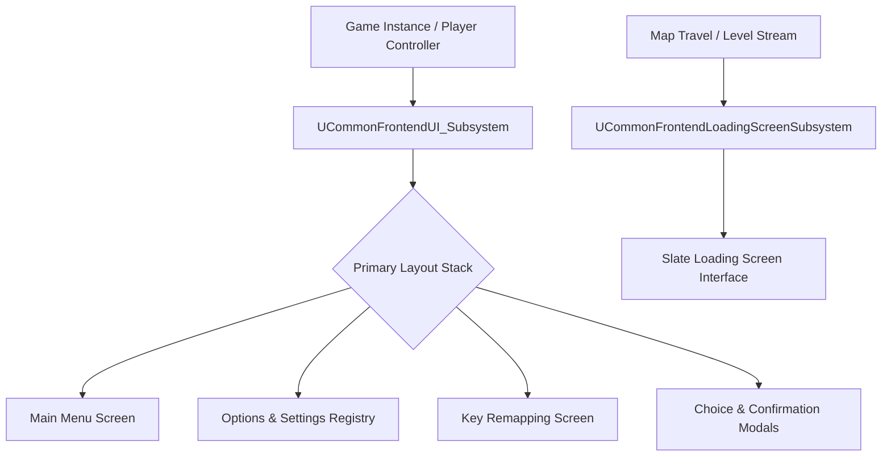

# Common Frontend UI for Unreal Engine 5

[](https://www.unrealengine.com/)
[](README.md)
[](LICENSE)
[](https://www.linkedin.com/in/shankharaj-datta-45921a28a/)
[](README.md)

**Common Frontend UI** is a modular, production-ready frontend framework for Unreal Engine 5 (UE 5.8+). Built on Epic's **CommonUI** and **Enhanced Input** systems, it delivers a decoupled, multi-platform UI architecture featuring a unified Settings Registry, interactive Key Remapping, Activatable Widget Stacks, and a dedicated Loading Screen subsystem.

> [!TIP]
> **Blueprint Ready**: Pre-compiled Win64 editor binaries (`.dll` + `.modules`) are included. Simply copy `CommonFrontendUI` into your project's `Plugins/` directory.

---

## 🚀 Key Modules & Capabilities

| Module | Core Functionality |
| :--- | :--- |
| **CommonFrontendUI** | Core UI subsystem, activatable widget stacks, choice dialogues, and settings registry. |
| **CommonFrontendUI_LoadingScreen** | Seamless background loading screens with custom Slate interface implementations. |

### Architectural Highlights
- **Settings Registry**: Data-driven options system integrating directly with `UGameUserSettings` for video, audio, and gameplay preferences.
- **Key Remapping Screen**: Native rebinding interface built for `EnhancedInput` with gamepad and keyboard support.
- **Activatable Widget Stack**: Async latent actions (`PushFrontendWidget`, `PushChoiceScreen`) managing layered menu hierarchies without hard references.
- **Loading Subsystem**: Independent loading state machine preventing frame hitching during map travel.

---

## 🏛️ System Overview



---

## 📋 Installation & Setup

1. Copy the `CommonFrontendUI` folder into your project's `Plugins/` directory:
   ```text
   YourProject/
   └── Plugins/
       └── CommonFrontendUI/
           ├── CommonFrontendUI.uplugin
           ├── Binaries/Win64/
           ├── Content/
           ├── Resources/
           └── Source/
   ```
2. Enable the **CommonUI** plugin in **Edit > Plugins**.
3. Enable **CommonFrontendUI** and restart the editor.

---

## 📄 License & Attribution

Distributed under the **MIT License**.

Created by **[Shankharaj Datta](https://www.linkedin.com/in/shankharaj-datta-45921a28a/)**.
