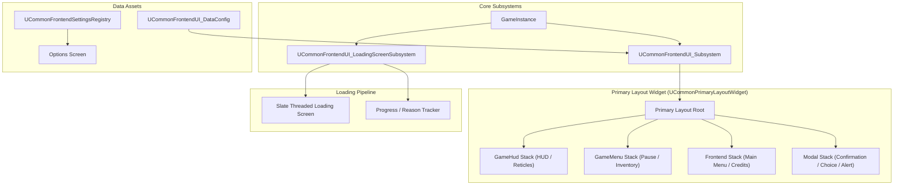

# Common Frontend UI — Comprehensive User Guide & Developer Manual

> **Plugin Version:** 1.0 (Production)  
> **Target Unreal Engine:** 5.8+  
> **Core Dependencies:** CommonUI, EnhancedInput  
> **Author:** Shankharaj Datta  

---

## Table of Contents
1. [Architecture Overview](#1-architecture-overview)
2. [Core Classes & Subsystems](#2-core-classes--subsystems)
3. [Quick Start: 5-Step Setup](#3-quick-start-5-step-setup)
4. [Gameplay Tag System](#4-gameplay-tag-system)
5. [Settings Registry System](#5-settings-registry-system)
6. [Key Remapping System](#6-key-remapping-system)
7. [Modal Choice Dialogues](#7-modal-choice-dialogues)
8. [Loading Screen Subsystem](#8-loading-screen-subsystem)
9. [Included Demo & Reference Assets](#9-included-demo--reference-assets)
10. [Troubleshooting & Best Practices](#10-troubleshooting--best-practices)

---

## 1. Architecture Overview

`CommonFrontendUI` solves one of the hardest problems in Unreal Engine game development: **managing UI screen flow, input routing, audio/video settings, and level-loading transitions in a completely decoupled, data-driven manner.**



### Architectural Principles
- **Zero Tight Coupling**: Screens and widgets communicate via Gameplay Tags and asynchronous event delegates rather than casting to concrete classes.
- **Async Soft Referencing**: Heavy UI textures, screens, and 3D models are referenced via `TSoftClassPtr` and `TSoftObjectPtr`. They load asynchronously on-demand and unload cleanly when popped.
- **CommonUI Native**: Built on Epic's `CommonActivatableWidget`, `CommonActivatableWidgetContainerBase`, and `CommonButtonBase`. Provides full controller/gamepad navigation, input action routing, back-button handling, and auto-focus out of the box.

---

## 2. Core Classes & Subsystems

### `UCommonFrontendUI_Subsystem` (GameInstanceSubsystem)
The central manager of runtime frontend state:
- **`Get(WorldContext)`**: Static accessor available in C++ and Blueprint.
- **`RegisterWidgetDataConfigAsync(InConfig, Callback)`**: Asynchronously instantiates the root primary layout widget from your config data asset.
- **`PushSoftWidgetToStackAsync(StackTag, WidgetClass, Callback)`**: Loads and pushes a widget class onto a specific tagged stack.
- **`PushSoftWidgetAsync(AssociatedTag, Callback)`**: Pushes a widget mapped to an associated tag (defined in your `UCommonFrontendUI_DataConfig`).
- **`PushChoiceScreenToModalStackAsync(Title, Message, Buttons, Callback)`**: Asynchronously displays a modal confirmation or multi-choice prompt.

### `UCommonPrimaryLayoutWidget` (Root UI Container)
Abstract base widget derived from `UCommonUserWidget`. It manages the physical screen layers on the viewport:
- Contains multiple `UCommonActivatableWidgetContainerBase` (CommonUI stack containers).
- Associates each container with a unique Gameplay Tag (e.g. `CFUI.WidgetStack.Frontend`, `CFUI.WidgetStack.Modal`) via `RegisterWidgetStack()`.

### `UCommonFrontendUI_DataConfig` (DataAsset)
Maps high-level screen tags to actual widget classes and input modes:
- **`PrimaryLayOutWidget`**: Soft reference to your root layout class.
- **`StackData`**: Array of entries mapping:
  - `StackTag` (e.g. `CFUI.WidgetStack.Frontend`)
  - `AssociatedTag` (e.g. `CFUI.AssociatedTag.MainMenu`)
  - `WidgetClass` (`TSoftClassPtr<UCommonFrontendActivatableWidget>`)
  - `UI_InputConfig` (`FUIInputConfig` with input mode, cursor capture, mouse lock).

---

## 3. Quick Start: 5-Step Setup

### Step 1: Create Your Primary Layout Widget
1. Create a Blueprint inheriting from `UCommonPrimaryLayoutWidget` (e.g., `WBP_MyPrimaryLayout`).
2. Add multiple **Common Activatable Widget Stack** containers in the UMG Designer (e.g., `Stack_Frontend`, `Stack_Menu`, `Stack_Modal`).
3. In the **Event Construct** or **Event Pre Construct**, register each stack:
   - Call `RegisterWidgetStack` with tag `CFUI.WidgetStack.Frontend` -> `Stack_Frontend`.
   - Call `RegisterWidgetStack` with tag `CFUI.WidgetStack.Modal` -> `Stack_Modal`.

### Step 2: Configure the UI Data Asset
1. Right-click in the Content Browser: **Miscellaneous > Data Asset**.
2. Select `CommonFrontendUI_DataConfig` (name it `DA_UIConfig`).
3. Set **Primary Layout Widget** to `WBP_MyPrimaryLayout`.
4. In **Stack Data**, add your screens:
   - **StackTag:** `CFUI.WidgetStack.Frontend`
   - **AssociatedTag:** `CFUI.AssociatedTag.MainMenu`
   - **WidgetClass:** `WBP_MainMenu`
   - **Input Config:** Input Mode = `UI Only`, Mouse Capture Mode = `No Capture`.

### Step 3: Initialize the Frontend at Level Start
In your Frontend GameMode or Controller:
- Use the Blueprint node **`Register Frontend UI Config`**:
  - Pass `DA_UIConfig` into the **Config Data** pin.
  - The node creates the root layout widget and attaches it to the viewport automatically.

### Step 4: Push Screens Dynamically
To transition between menus or open the Options screen:
- Call **`Push Frontend Widget`** (or **`Push Frontend Widget To Stack`**):
  - Pass `CFUI.AssociatedTag.OptionsMenu` (or `CFUI.WidgetStack.Frontend`).
  - Set `bAutoFocus = true`.
- CommonUI automatically disables input on the previous screen in the stack and routes navigation to the newly pushed screen!

### Step 5: Returning / Going Back
Because all widgets derive from `UCommonFrontendActivatableWidget`, pressing the Gamepad Face-Button Right (B / Circle) or keyboard Escape triggers `GetDesiredInputConfig()` and pops the top widget off the stack, seamlessly returning focus to the underlying screen.

---

## 4. Gameplay Tag System

The plugin declares standard native gameplay tags under the `CFUI_GameplayTags` namespace:

### Screen Layers (Widget Stacks)
| Gameplay Tag | Purpose | Typical Layer Depth |
| :--- | :--- | :---: |
| `CFUI.WidgetStack.GameHud` | In-game HUD, crosshairs, health bars | 0 |
| `CFUI.WidgetStack.GameMenu` | In-game pause menu, inventory, map | 10 |
| `CFUI.WidgetStack.Frontend` | Title screen, main menu, settings | 20 |
| `CFUI.WidgetStack.Modal` | Confirmation prompts, error alerts | 100 |

### Associated Screen Identifiers
| Gameplay Tag | Description |
| :--- | :--- |
| `CFUI.AssociatedTag.MainMenu` | Main navigation title screen |
| `CFUI.AssociatedTag.OptionsMenu` | Settings and preferences menu |
| `CFUI.AssociatedTag.KeyRemapScreen` | Enhanced Input remapping interface |
| `CFUI.AssociatedTag.Credits` | Credits roll |
| `CFUI.AssociatedTag.LoadingScreen` | Map transition overlay |
| `CFUI.AssociatedTag.ConfirmationDialog` | Yes/No or custom choice dialogue |
| `CFUI.AssociatedTag.NotificationPopup` | Toast alert notification |

---

## 5. Settings Registry System

The Settings Registry (`UCommonFrontendSettingsRegistry`) eliminates hardcoded options menus by allowing designers to construct robust, hierarchical settings tabs entirely in Data Assets.

### Setting Types Available

| Setting Class | UI Representation | Backing Property / Function |
| :--- | :--- | :--- |
| `UFrontendSettingScalar` | **Slider** | Float or Integer (e.g. Master Volume, FOV, Gamma). Includes min/max, step size, and display format (Percentage, Number). |
| `UFrontendSettingBool` | **Toggle / Checkbox** | Boolean (e.g. VSync, Motion Blur). Customizable `TrueText` ("ON") and `FalseText` ("OFF"). |
| `UFrontendSettingString` | **Dropdown / ComboBox** | String or Enum (e.g. Anti-Aliasing Quality, Window Mode). Defined by `FFrontendStringSelection` pairs. |
| `UFrontendSettingResolution` | **Resolution Selector** | Auto-queries supported monitor resolutions from `UGameUserSettings`. |
| `UFrontendSettingControls` | **Input Mapping List** | Dynamically populates all rebindable actions from Enhanced Input contexts. |
| `UFrontendSettingNestedTab` | **Subcategory Tab** | Groups child settings under a secondary tab bar within a main tab. |

### Property Binding Modes
Each setting value can bind in two ways:
1. **Property Binding (`TargetProperty`)**:
   - Provide the exact name of a property on `UGameUserSettings` (e.g., `bUseVSync`, `FrameRateLimit`).
2. **Manual Function Binding (`GetterFunctionName` / `SetterFunctionName`)**:
   - Provide the names of custom getter/setter functions on your `UGameUserSettings` subclass.

### Conditional Enabling & Visibility Rules
Settings can be conditionally grayed out or forced to specific values using modular edit conditions:
- **`UFrontendSettingDependency`**: Enables or disables a setting based on the state of another setting (e.g. disable "Ray Tracing Reflections" if "Ray Tracing" is OFF). Supports `AllowedValues` and `DisallowedValues`.
- **`UFrontendSettingCompositeCondition`**: Chains multiple conditions using `AND` or `OR` operators.
- **`UFrontendSettingBuildCondition`**: Toggles visibility or editability based on build configuration (`bEditInShipping`, `bEditInDevelopment`, `bDisableInEditor`).

---

## 6. Key Remapping System

The `UCommonFrontendKeyRemapScreen` provides a complete controller and keyboard rebinding interface powered by Unreal Engine's **Enhanced Input**:
- Displays actions organized by Input Mapping Context (`UInputMappingContext`).
- Detects key conflicts and duplicate bindings automatically.
- Supports separate profile slots for Keyboard/Mouse vs. Gamepad.
- Integrates with `UFrontendSettingControls` inside the Settings Registry.

---

## 7. Modal Choice Dialogues

To display confirmation prompts ("Quit Game?", "Apply Video Changes?", "Overwrite Save?"), use the asynchronous node **`Show Choice Screen`** (`UAsyncAction_PushChoiceScreen`):

```text
[Show Choice Screen]
  ├── ScreenTitle: "Confirm Exit"
  ├── ScreenMessage: "Are you sure you want to exit to desktop? Unsaved progress will be lost."
  ├── ButtonLabels: ["Cancel", "Exit"]
  └── OnButtonClicked(SelectedLabel)
        ├── If SelectedLabel == "Exit"   -> Quit Game
        └── If SelectedLabel == "Cancel" -> (Screen closes automatically)
```

The choice screen is pushed directly to `CFUI.WidgetStack.Modal`, capturing focus and blocking clicks to background menus until dismissed.

---

## 8. Loading Screen Subsystem

The plugin includes a dedicated loading screen module: `CommonFrontendUI_LoadingScreen`.

### Key Features
- **Zero-Hitch Transitions**: Spawns an independent Slate-level loading overlay before map travel begins, ensuring no freezing or stutter during engine garbage collection and asset deserialization.
- **Project Settings Integration**: Configured in **Project Settings > Game > Common Frontend Loading Screen Settings**:
  - `SoftLoadingScreenWidgetClass`: Soft class reference to your custom UMG loading widget.
  - `HoldLoadingScreenExtraSeconds`: Minimum duration to hold the screen so fast-loading levels don't flicker (default: `3.0s`).
  - `bShowProgress`: Toggles Slate progress percentage display.
  - `bShouldShowLoadingScreenInEditor`: Enable/disable during PIE sessions.
- **Level Travel Helper**:
  Call `OpenLevelWithLoadingScreen(WorldContext, LevelPtr, bAbsolute, Options, Delay)` to smoothly initiate travel with an automated pre-load delay.

---

## 9. Included Demo & Reference Assets

The plugin includes a complete, functioning frontend setup in its `Content/` directory:
- **`Content/Map/L_Demo.umap`**: Playable showcase level testing all features.
- **`Content/Blueprint/BP_FrontendGameMode`**: Reference frontend GameMode.
- **`Content/Blueprint/BP_FrontendController`**: PlayerController configured with UI input routing.
- **`Content/CFSR_Default_Plugin.uasset`**: Pre-configured Settings Registry Data Asset with Graphics, Audio, Display, and Controls tabs.
- **`Content/CFUDC_Default_Plugin.uasset`**: Pre-configured UI Data Config mapping all standard screens.
- **`Content/Audio/`**: Sound cues for button clicks, hover effects, and background music (`MSS_BGM_Plugin_ShowCase`).

---

## 10. Troubleshooting & Best Practices

| Issue | Cause | Solution |
| :--- | :--- | :--- |
| **Widget does not receive gamepad focus** | Container is not set as an active CommonUI stack | Ensure the parent container derives from `UCommonActivatableWidgetContainerBase` and `bAutoFocus = true` is passed. |
| **Loading screen does not appear in PIE** | Editor display disabled in settings | Go to **Project Settings > Common Frontend Loading Screen Settings** and enable `bShouldShowLoadingScreenInEditor`. |
| **Settings values not persisting across restarts** | Auto-save disabled | Set `bAutoSaveOnChange = true` on the setting definition, or call `SaveSettings()` on `UGameUserSettings`. |
| **Key remapping not updating character** | Enhanced Input subsystem not notified | Ensure your player controller applies the modified `UInputMappingContext` through the Enhanced Input Local Player Subsystem. |
